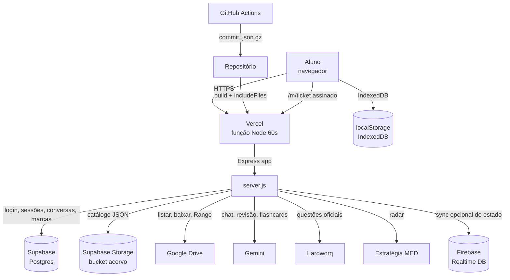
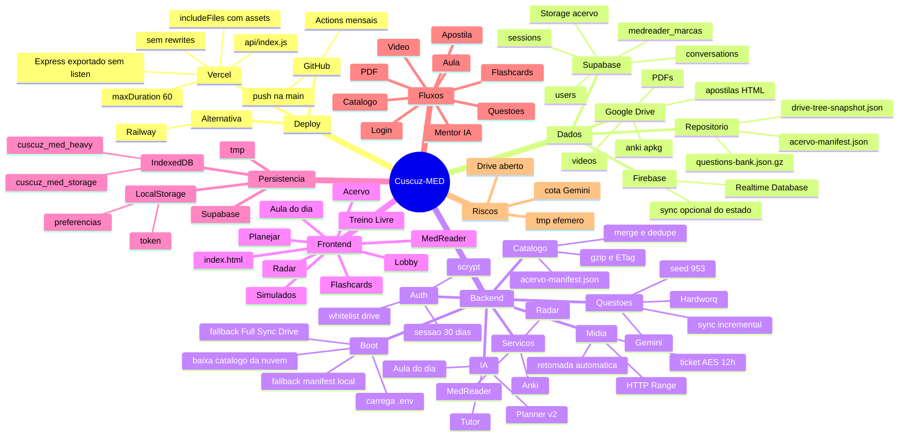

# Cuscuz-MED — Arquitetura e Fluxos
### Documento-fonte para uma IA desenhar o mapa mental do sistema

> **Como usar este documento**
> 1. Se a IA/ferramenta aceita **Mermaid** → use os blocos das seções 4 e 5.
> 2. Se aceita **texto hierárquico** (XMind, Whimsical, MindMeister, ChatGPT/Claude) → use o outline da seção 6.
> 3. Se aceita **JSON** → use o apêndice C.
> 4. O prompt da seção 2 já está pronto para copiar e colar.
>
> **Fonte:** código em `noroja/cuscuz` (commit `f111a61`), produção em `https://cuscuz-nu.vercel.app/`, inspeção de 19/10/2026.
> **Regra:** os nomes de arquivos, rotas e coleções abaixo são reais. Não invente módulos.

---

## 1. Ficha técnica (números reais)

| Item | Valor |
|---|---|
| Frontend | `index.html` monolítico (677 KB, 11.272 linhas) + `planner-v2.js` (486) + `aula-dia.js` (554) + 6 módulos em `js/` |
| Backend | Express 4 (ESM), `server.js` (186 KB, 3.430 linhas) + 12 módulos em `src/` |
| Rotas | ~68 (46 em `server.js`, 24 nos módulos `src/`) |
| Deploy | Vercel (serverless, Node) + Supabase + Google Drive + Gemini |
| Função serverless | `api/index.js` → importa `server.js` → exporta o app Express |
| Limite de execução | 60 s (`maxDuration`) |
| Banco de questões no repo | 953 questões (`data/questions-bank.json`, 1,3 MB) |
| Catálogo durável (Supabase) | **10.532 vídeos / 19.239 materiais** (produção, 19/10/2026) |
| Catálogo fallback no repo | 2.143 vídeos / 5.723 materiais (`acervo-manifest.json`, 2,6 MB) |
| Snapshot do Drive | 1,2 MB (`drive-tree-snapshot.json`) |
| Estado do frontend pesado | IndexedDB (2 bancos), não localStorage |
| Usuários | scrypt + sessões de 30 dias |
| Mídia | tickets AES-256-GCM de 12 h; streaming com HTTP Range |

**O que já foi validado em produção:** login, sessão, catálogo, 953 questões, listagem do Drive, PDF de 3 MB, HTML de apostila, metadados de vídeo, SSE do Mentor IA e recarga autenticada (61 requisições, 0 erros).

**Único bloqueio atual:** cota gratuita do Gemini esgotada (20 req/dia por modelo). O sistema cai automaticamente no mentor por regras (`ia:false`), sem quebrar.

---

## 2. Prompt pronto para a IA desenhar o mapa mental

```text
Desenhe um mapa mental hierárquico do sistema Cuscuz-MED a partir da documentação abaixo.

Regras:
- Raiz: "Cuscuz-MED". Primeiro nível: Deploy, Dados, Backend, Frontend, Fluxos, Riscos.
- Mantenha exatamente os nomes de arquivos, rotas, tabelas e coleções.
- Máximo 4 níveis de profundidade; use verbos curtos nos nós de fluxo.
- Marque com "[durável]" o que persiste (Supabase, GitHub, Drive) e "[efêmero]" o que vive em /tmp ou só no navegador.
- Não invente módulos, endpoints ou integrações que não estejam no texto.
- Destaque no mapa: (a) o caminho de uma requisição até o Express; (b) o caminho de um vídeo/PDF até o navegador; (c) o caminho do Mentor IA com SSE e fallback.
- Ao final, gere uma legenda com 6 cores: Deploy, Dados, Backend, Frontend, Fluxo, Risco.
```

---

## 3. Visão em um parágrafo

O Cuscuz-MED é uma plataforma de estudos médicos com três pilares: **acervo** (vídeos, PDFs e apostilas HTML no Google Drive), **questões** (banco próprio + Hardworq + geração por IA) e **planejamento** (Mentor IA que entrevista o aluno e monta cronograma). O navegador é um SPA monolítico; o servidor é um Express que roda como função serverless na Vercel. O estado **durável** vive no Supabase (usuários, sessões, conversas, marcas de leitura e catálogo no Storage), no GitHub (banco de questões compactado) e no Google Drive (arquivos). O disco da função é somente leitura; tudo que precisa ser gravado em tempo de execução vai para `/tmp` e é descartável. A IA usa Gemini com fallback por regras; mídia usa tickets assinados e streaming com `Range`; o catálogo é servido em JSON compactado com gzip/ETag.

---

## 4. Diagrama de contexto (Mermaid)



---

## 5. Mapa mental (Mermaid)



---

## 6. Outline hierárquico (para ferramentas sem Mermaid)

```text
Cuscuz-MED
├── 1. DEPLOY
│   ├── Vercel (produção)
│   │   ├── api/index.js              → importa server.js e exporta o app
│   │   ├── server.js                 → sem app.listen em serverless
│   │   ├── vercel.json               → maxDuration 60
│   │   ├── includeFiles              → html, css, js, data, manifestos
│   │   └── sem rewrites              → preserva o path original no Express
│   ├── GitHub
│   │   ├── push na main              → deploy automático
│   │   └── Actions
│   │       ├── banco-questoes.yml    → 1º de cada mês, commita .json.gz
│   │       └── keepalive.yml         → ainda aponta para o Railway (legado)
│   └── Railway (legado)
│       └── cuscuz-med-production.up.railway.app
│
├── 2. DADOS
│   ├── Supabase [durável]
│   │   ├── Postgres
│   │   │   ├── users               → username, password_hash, salt, role
│   │   │   ├── sessions            → token, expires_at (30 dias)
│   │   │   ├── conversations       → chat/tutor por usuário
│   │   │   └── medreader_marcas    → marcações de leitura
│   │   └── Storage
│   │       └── bucket acervo/acervo-manifest.json
│   ├── Google Drive [durável]
│   │   ├── vídeos                  → streaming
│   │   ├── PDFs                    → proxy/pdf.js
│   │   ├── apostilas HTML          → reader
│   │   └── .apkg                   → importação Anki
│   ├── Firebase Realtime Database [durável, opcional]
│   │   └── users/<user>/state      → espelho do estado do aluno
│   ├── Repositório [durável]
│   │   ├── data/questions-bank.json.gz
│   │   ├── acervo-manifest.json    → fallback 2.143/5.723
│   │   └── drive-tree-snapshot.json
│   └── /tmp [efêmero]
│       ├── questions-bank.json     → arquivo de trabalho
│       ├── hwq-token.json          → cache legado (fonte é system_configs)
│       ├── extra-manifest.json
│       ├── radar_medico_cache.json
│       └── decks/ e cache de apostilas
│
├── 3. BACKEND
│   ├── Boot
│   │   ├── loadDotEnv()
│   │   ├── inicializarCatalogoNuvem()
│   │   │   ├── 1. baixa do Supabase Storage
│   │   │   ├── 2. se vazio → Full Sync no Drive
│   │   │   └── 3. se falhar → acervo-manifest.json local
│   │   ├── initSnapshotIndex()
│   │   └── preloadQuestionsBank()
│   ├── Middlewares
│   │   ├── express.json 50 MB
│   │   ├── BLOCKED_STATIC              → nunca expõe código/dados
│   │   ├── authMiddleware /api        → sessão HttpOnly nas APIs privadas; exceções explícitas
│   │   ├── 404 JSON para /api/*
│   │   └── SPA fallback (só sem extensão)
│   └── Módulos src/
│       ├── fs-safe.js                  → IS_SERVERLESS, TMP_DIR, writableDir
│       ├── auth-multiuser.js           → scrypt + sessões
│       ├── drive-auth.js               → service account / API key
│       ├── drive.js                    → helpers do Drive
│       ├── extra-drive.js              → catálogo e Delta Sync
│       ├── supabase-catalog.js         → download/upload do catálogo
│       ├── apostila-reader.js          → HTML/CSS das apostilas
│       ├── aula.js                     → transcrição, mapa, flashcards
│       ├── planner-engine.js           → regras, perfil, catálogo
│       ├── planner-routes.js           → chat/manual/enrich + SSE
│       ├── questoes-aula.js            → matching de questões
│       └── medreader-marcas.js         → marcas de leitura
│
├── 4. FRONTEND
│   ├── index.html
│   │   ├── Login / Supabase
│   │   ├── Lobby
│   │   ├── Planejar (planner-v2.js)
│   │   ├── Acervo (Drive)
│   │   ├── Treino Livre (questões)
│   │   ├── Simulados
│   │   ├── Flashcards
│   │   ├── Radar
│   │   └── MedReader (PDF/apostila)
│   ├── aula-dia.js + aula.html         → pipeline da aula
│   ├── js/medreader-*.js               → leitor, marcas, export, flashcards
│   └── js/onboarding-tour.js
│
├── 5. PERSISTÊNCIA DO NAVEGADOR
│   ├── localStorage (leve)
│   │   ├── cuscuz_token
│   │   ├── medplan_logged
│   │   ├── medplan_user
│   │   └── tema/preferências
│   └── IndexedDB
│       ├── cuscuz_med_heavy/heavy_state
│       │   ├── acervo e Drive
│       │   ├── histórico de simulados
│       │   ├── decks, flashcards e SRS
│       │   └── planner-v2-plan / planner-v2-chat
│       └── cuscuz_med_storage (v2)
│           ├── questions_bank
│           ├── pinned_pdfs
│           └── drive_folder_cache
│
├── 6. FLUXOS
│   ├── Login → cookie HttpOnly → sessão validada no servidor
│   ├── Catálogo → Supabase → fallback Drive → fallback repo
│   ├── Vídeo → ticket → /m/:ticket → Range → Drive
│   ├── PDF → proxy → Drive
│   ├── Apostila → HTML → pipe
│   ├── Questões → seed/tmp → treino/simulado
│   ├── Mentor IA → SSE → Gemini → fallback regras
│   ├── Aula → transcrição → mapa → flashcards
│   └── Flashcards → SRS no navegador
│
└── 7. RISCOS
    ├── Cota gratuita do Gemini (20/dia)
    ├── /tmp é apagado a cada instância
    ├── APIs privadas exigem sessão; /m/:ticket é uma credencial temporária de posse
    └── Catálogo grande (10 MB cru / 1,9 MB gzip)
```

---

## 7. Estrutura de arquivos

```text
cuscuz/
├── api/index.js                 entrada serverless (export default app)
├── server.js                    Express: boot, auth, Drive, questões, IA, estáticos
├── vercel.json                  build + includeFiles + maxDuration
├── assets/login/                pranchas do login (jpg/webm), copiadas no build e no bundle
├── scripts/
│   ├── build-public.js          copia assets para public/ (build)
│   ├── baixar-banco.mjs         baixa o banco do Hardworq (Action)
│   └── full-sync.cjs            sincronização manual do Drive
├── src/
│   ├── fs-safe.js               helpers de disco para serverless
│   ├── auth-multiuser.js        scrypt, sessões, Supabase
│   ├── drive-auth.js            credenciais do Drive
│   ├── drive.js                 helpers de arquivos/pastas
│   ├── extra-drive.js           catálogo, Delta/Full Sync
│   ├── supabase-catalog.js      Storage bucket acervo
│   ├── apostila-reader.js       HTML/CSS das apostilas
│   ├── aula.js                  pipeline da aula
│   ├── planner-engine.js        motor de regras do planejador
│   ├── planner-routes.js        rotas do mentor + SSE
│   ├── questoes-aula.js         seleção de questões por tema
│   └── medreader-marcas.js      marcações no Supabase
├── index.html                   SPA principal
├── aula.html + aula-dia.js      tela da aula
├── planner-v2.js                chat + cronograma
├── js/
│   ├── medreader-core.js
│   ├── medreader-flashcards.js
│   ├── medreader-export.js
│   ├── medreader-integracao.js
│   ├── medreader-marcas.js
│   ├── onboarding-tour.js
│   └── vendor/localforage.min.js
├── css/
├── data/
│   ├── questions-bank.json      seed somente-leitura (953)
│   └── radar_medico_cache.json
├── acervo-manifest.json         fallback do catálogo
├── drive-tree-snapshot.json     índice offline de pastas
└── supabase-schema.sql          users, sessions, conversations, medreader_marcas
```

> `public/` é **gerado** pelo build e ignorado pelo git. O `express.static()` não é o que serve os assets na Vercel: o bundle da função (`includeFiles`) é quem carrega `index.html`, `css/`, `js/` e os manifestos.

---

## 8. Ordem de execução no backend

1. **Importação** de `server.js` (uma vez por instância).
2. `loadDotEnv()` — lê `.env` sem sobrescrever variáveis já presentes.
3. `DATA_DIR = writableDir(data/)` → em serverless, `/tmp/cuscuz-med`; local, `./data`.
4. Cria o Express e registra `express.json({ limit: '50mb' })`.
5. Registra rotas de auth (`registerAuthRoutes`).
6. `app.use('/api', authMiddleware)` — APIs privadas exigem sessão; exceções controladas: autenticação/convites/recuperação, health básico, config e cron com segredo.
7. Define `/api/health` depois do middleware: health básico é público; detalhes e diagnóstico `?deep=1` exigem administrador.
8. Bloqueia arquivos internos (`BLOCKED_STATIC`).
9. Inicializa Gemini (client + circuit breaker de quota).
10. Inicializa Supabase (users/conversas) e o catálogo em nuvem (assíncrono).
11. Pré-carrega o banco de questões em background.
12. Registra rotas de catálogo, mídia, questões, planner, aula, apostila, Anki.
13. Registra `404` JSON para `/api/*` e fallback SPA para o resto.
14. **Se não for serverless** → `app.listen()` + timers (Hardworq, extras, auto-feed).
15. **Se for serverless** → exporta `app` (sem `listen`).

---

## 9. Mapa de rotas

### 9.1 Autenticação e configuração

| Método | Rota | Observação |
|---|---|---|
| GET | `/api/health` | público; retorna somente disponibilidade; detalhes exigem administrador |
| GET | `/api/config` | público; devolve URL e anon key do Supabase |
| GET | `/api/auth/check-username` | fechado; cadastro é por convite |
| POST | `/api/auth/signup` | sempre negado |
| POST | `/api/auth/login` | cria cookie HttpOnly de sessão |
| POST | `/api/auth/google` | permite identidade já autorizada |
| POST | `/api/auth/invitations/accept` | aceita convite verificado e de uso único |
| POST | `/api/auth/password-reset/request` | recuperação genérica por e-mail vinculado |
| POST | `/api/auth/password-reset/complete` | redefine senha com sessão confirmada e token de recuperação de uso único |
| POST | `/api/auth/logout` | invalida sessão e limpa cookie |
| GET | `/api/auth/me` | restaura cookie e aceita bearer legado apenas para migração |
| POST | `/api/auth/update-profile` | exige sessão; altera nome |
| GET/POST/PATCH | `/api/admin/*` | painel restrito a admin/super_admin |

### 9.2 Catálogo e acervo

| Método | Rota | Observação |
|---|---|---|
| GET | `/acervo-manifest.json` | **exige login**; merge + gzip + ETag |
| GET | `/api/acervo/extra-status` | estado da varredura de extras |
| POST | `/api/acervo/extra-scan` | dispara varredura em background |
| GET | `/api/planner/v2/catalogo` | resumo de disciplinas/cursos/vídeos |

### 9.3 Drive e mídia

| Método | Rota | Observação |
|---|---|---|
| GET | `/api/drive/list?folderId=` | lista pastas/arquivos |
| GET | `/api/drive/materials?course=` ou `?videoId=` | materiais de um curso/aula |
| GET | `/api/drive/video-info?ids=` | metadados (mime, tamanho, duração, resolução) |
| GET | `/api/drive/clear-cache` | limpa cache de listagem |
| POST | `/api/media/ticket` | sela `{id, kind}` por 12 h → `/m/<token>` |
| ALL | `/m/:ticket` | **público** (link assinado) → vídeo ou PDF |
| ALL | `/api/drive/stream/:id` | vídeo com HTTP Range e retomada |
| GET | `/api/drive/pdf/:id` | PDF em streaming |

> `/api/drive/*` e `/api/media/ticket` exigem sessão. `/m/:ticket` é um link bearer criptografado AES-256-GCM, válido por até 12 h; configure `MEDIA_TICKET_SECRET` ou `APP_PASSWORD` nos dois hosts.

### 9.4 Questões

| Método | Rota | Observação |
|---|---|---|
| GET | `/api/questions/bank` | banco completo (953 no seed) |
| GET | `/api/questions/match` | questões por disciplina/tema/módulo |
| POST | `/api/questions/bank/sync` | merge + lotes incrementais por cursor |
| POST | `/api/questions/bank/restore` | restaura banco vindo do navegador |
| GET | `/api/questions/hardworq/doencas` | catálogo de doenças do Hardworq |
| GET | `/api/questions/hardworq/status` | estado do login/sync |
| GET | `/api/questions/hardworq/sync-status` | progresso do espelhamento |
| POST | `/api/questions/hardworq/sync` | força sincronização |
| POST | `/api/questions/hardworq/answer` | registra resposta |
| GET | `/api/questions/hardworq/aluno` | dados do aluno |
| POST | `/api/questions/import-hardworq` | importa JSON/login/cookie |
| GET | `/api/questions/mirror` | status do espelho contínuo |
| POST | `/api/questions/auto-feed` | alimenta o banco sozinho |
| POST | `/api/gemini/generate-questions` | gera questões inéditas |
| POST | `/api/gemini/tutor` | tutor conversacional |

### 9.5 Mentor IA e planejador

| Método | Rota | Observação |
|---|---|---|
| POST | `/api/planner/chat` | entrevista adaptativa; **SSE opcional** |
| POST | `/api/planner/manual` | plano a partir de texto manual; **SSE** |
| POST | `/api/planner/enrich` | enriquece tarefas; **SSE** |
| POST | `/api/planner/generate-tasks` | fecha o plano e gera tarefas |
| POST | `/api/planner/generate` | geração legada |
| POST | `/api/planner/synergy-generate` | geração sinérgica |
| POST | `/api/planner/apply-updates` | aplica ajustes |
| POST | `/api/planner/update-exams` | atualiza provas |
| POST | `/api/planner/replan` | replaneja |
| POST | `/api/planner/replan-imprevisto` | replaneja imprevisto |
| GET/POST | `/api/planner/deck` | deck de flashcards por matéria/tema |

**SSE (`enableSSE`):** ativado com `Accept: text/event-stream` ou `body.stream === true`. Envia comentário `: keep-alive` a cada 10 s e finaliza com `event: result` + JSON. Sem SSE, a mesma rota responde `application/json` normalmente.

### 9.6 Aula do dia

| Método | Rota |
|---|---|
| GET | `/api/aula/status` |
| POST | `/api/aula/transcrever` |
| POST | `/api/aula/revisar` |
| POST | `/api/aula/mapa` |
| POST | `/api/aula/capitulo` |
| POST | `/api/aula/fechamento` |
| POST | `/api/aula/flashcards` |
| POST | `/api/aula/processar` |

### 9.7 Apostilas, MedReader e Anki

| Método | Rota | Observação |
|---|---|---|
| GET | `/api/apostila/list?folderId=` | lista HTML no Drive |
| GET | `/api/apostila/html/:id` | baixa, injeta CSS e faz `.pipe(res)` |
| GET | `/api/apostila/css-mestre` | CSS compartilhado |
| GET/PUT | `/api/medreader/marcas/:id` | marcações no Supabase |
| POST | `/api/anki/importar` | importa `.apkg` |
| GET | `/api/anki/download/:fileId` | baixa o `.apkg` |

### 9.8 Radar, chat e conversas

| Método | Rota | Observação |
|---|---|---|
| GET | `/api/radar-medico?force=true` | scraping do Estratégia MED + cache durável de 24 h |
| POST | `/api/chat` | chat com OpenAI (opcional) |
| GET | `/api/conversations/:id` | histórico |
| DELETE | `/api/conversations/:id` | apaga conversa |

---

## 10. Persistência: o que é durável e o que é descartável

| Dado | Onde vive | Durável? | Fallback |
|---|---|---|---|
| Usuários e senhas | Supabase `users` | sim | `users.json` em `/tmp` |
| Sessões | Supabase `sessions` | sim | `sessions.json` em `/tmp` |
| Conversas | Supabase `conversations` | sim | memória |
| Marcas do MedReader | Supabase `medreader_marcas` | sim | memória |
| Catálogo de aulas | Supabase Storage `acervo` | sim | Full Sync → `acervo-manifest.json` |
| Token do Delta Sync | Supabase Storage `acervo/drive-change-token.json` + `data/sync-token.json` | sim, com Supabase | Full Sync para reconstruir |
| Banco de questões (seed) | `data/questions-bank.json` no repo | sim | — |
| Banco de questões (trabalho) | `/tmp/questions-bank.json` + Supabase Storage `acervo/questions-bank.json` | sim, com Supabase | recarrega o seed/Storage |
| Banco oficial atualizado | `data/questions-bank.json.gz` no GitHub | sim | Action mensal |
| Token do Hardworq | Supabase `system_configs` (`hwq_token`) ou bucket privado `system` | sim | relogin automático sob demanda |
| Mirror do Hardworq | `/tmp/hwq-mirror.json` | não | recomeça |
| Cache do Radar + marca da IA | Supabase `system_configs`/bucket `system` | sim | `/tmp`/seed `radar-medico.json` |
| Decks do planejador | `/tmp/decks/` | não | regeneração |
| Plano e chat do aluno | IndexedDB do navegador | sim (por dispositivo) | — |
| Espelho do estado do aluno | Firebase RTDB `users/<user>/state` | sim (opcional) | localStorage/IndexedDB |
| Acervo em cache | IndexedDB `cuscuz_med_heavy` | sim (por dispositivo) | recarrega da API |
| Questões offline | IndexedDB `cuscuz_med_storage` | sim (por dispositivo) | recarrega da API |

**Regra de ouro:** nada de estado mutável em `data/` na Vercel. `DATA_DIR` resolve para `/tmp`; escritas usam `safeWriteJson` (atômico e sem exceção).

---

## 11. Fluxos passo a passo

### 11.1 Boot da aplicação

1. A Vercel carrega `api/index.js`.
2. `api/index.js` importa `server.js`.
3. `server.js` detecta `VERCEL` → `IS_SERVERLESS = true`.
4. `DATA_DIR` aponta para `/tmp/cuscuz-med`.
5. `inicializarCatalogoNuvem()` roda em background:
   - garante o bucket `acervo`;
   - baixa `acervo-manifest.json` do Storage → `setCatalogo()` → `CAT` em memória;
   - se vazio → Full Sync no Drive;
   - se ainda vazio → lê o `acervo-manifest.json` do repositório.
6. `initSnapshotIndex()` monta o índice de pastas a partir de `drive-tree-snapshot.json`.
7. `preloadQuestionsBank()` carrega o seed em memória.
8. O app é exportado **sem** `app.listen()`.
9. A primeira requisição encontra o Express pronto; os dados podem terminar de carregar em paralelo.

### 11.2 Login e sessão

1. O aluno envia usuário e senha para `POST /api/auth/login`.
2. `ensureAuthLoaded()` carrega usuários do Supabase (ou do `/tmp`).
3. `scrypt` verifica a senha com `timingSafeEqual`.
4. O servidor gera 32 bytes aleatórios (token) e grava a sessão com validade de 30 dias.
5. A resposta define um cookie HttpOnly e devolve apenas os dados do usuário.
6. O front grava um marcador de compatibilidade e o nome/estado da conta, nunca o token de sessão.
7. As chamadas seguintes usam o cookie same-origin; o servidor confirma a sessão armazenada.
8. Ao abrir o site, `GET /api/auth/me` restaura a sessão; sem token válido, volta ao login.
9. Logout apaga a sessão no servidor e as chaves no navegador.

### 11.3 Catálogo do acervo

1. O front chama `GET /acervo-manifest.json` com o Bearer token.
2. O servidor valida a sessão (401 se inválida).
3. `lerExtra()` devolve `CAT` (carregado do Supabase).
4. `juntarExtras()` faz merge com o manifesto empacotado e remove duplicados por `id`.
5. O resultado é serializado uma vez e cacheado em memória (`raw`, `gz`, `ETag`).
6. Se o cliente aceita gzip, responde com `Content-Encoding: gzip`; senão, JSON puro.
7. Se o `If-None-Match` bate, responde `304`.
8. O navegador guarda o resultado no IndexedDB (`cuscuz_med_acervo_cache`).
9. A UI monta cursos → módulos → aulas → materiais.

**Números de produção:** 10.532 vídeos, 19.239 materiais, 1,9 MB gzip, ~1 s.

### 11.4 Vídeo (streaming com Range)

1. A UI pede metadados: `GET /api/drive/video-info?ids=<id>`.
2. O servidor consulta o Drive e devolve `mimeType`, `sizeMB`, `durLabel`, `res`.
3. A UI pede um ticket: `POST /api/media/ticket { id, kind: "v" }`.
4. O servidor sela `{i, k, e}` com AES-256-GCM e devolve `/m/<token>`.
5. O `<video>` aponta para esse link e começa a enviar `Range: bytes=...`.
6. `/m/:ticket` abre o ticket, delega para `driveStreamHandler`.
7. O handler repassa o `Range` ao Drive, devolve `206 Partial Content` e faz `pipe` para a resposta.
8. Se a conexão cair, o handler retoma do byte onde parou.
9. `HEAD` e `OPTIONS` são suportados (CORS).

### 11.5 PDF

1. A UI chama `/api/drive/pdf/:id` (ou um ticket `kind: "p"`).
2. O servidor abre o arquivo no Drive e faz streaming `inline`.
3. `Range` é respeitado; o `pdf.js` renderiza no canvas.
4. Nada é gravado em disco.

### 11.6 Apostila HTML

1. A UI lista os HTML de uma pasta: `GET /api/apostila/list?folderId=...`.
2. Ao abrir: `GET /api/apostila/html/:id`.
3. O servidor baixa o HTML do Drive, injeta o CSS mestre e **faz `.pipe(res)`**.
4. O cache de HTML/CSS fica em `/tmp` (efêmero).
5. Se o HTML referencia imagens externas, o navegador as busca direto na origem.

### 11.7 Questões

**Leitura**
1. `GET /api/questions/bank` devolve o banco em memória.
2. Se o cache não existe, lê `/tmp/questions-bank.json`; se não existe, lê o seed do repo (ou o `.gz`).
3. A UI guarda no IndexedDB (`questions_bank`) para uso offline.

**Treino livre**
1. A UI envia disciplina/tema/módulo para `GET /api/questions/match`.
2. O servidor seleciona por conceitos e limite (1–60).
3. Opcional: completa com questões inéditas do Gemini.
4. Opcional: busca questões vivas no Hardworq pelas doenças correspondentes.
5. A UI monta o runner e grava acertos/erros no IndexedDB.

**Simulados**
1. A UI filtra o banco por área/ano/instituição.
2. Respostas ficam em `cuscuz_exam_answers` (IndexedDB).
3. O histórico e o gabarito são calculados no cliente.

**Sincronização**
1. `POST /api/questions/bank/sync` recebe `{ questions, since, limit }`.
2. O servidor faz merge por `id` e responde em lotes com cursor `createdAt|id`.
3. Em serverless, o merge vive em `/tmp` e desaparece com a instância.
4. A atualização **durável** é o `.json.gz` commitado pela Action mensal.

**Hardworq**
1. Login com `HARDWORQ_EMAIL`/`HARDWORQ_SENHA`.
2. Lista de doenças → seleção por tema.
3. Busca por `ids_doencas` com limite.
4. Espelho contínuo (somente fora da Vercel) para manter o banco completo.

### 11.8 Mentor IA (Planner v2) com SSE

1. A aba **Planejar** monta `#planner-ia-root` via `planner-v2.js`.
2. O aluno responde à entrevista; o front envia `POST /api/planner/chat` com `messages`, `perfil` e `hoje`.
3. O front pede SSE (`Accept: text/event-stream`).
4. `enableSSE()` responde `text/event-stream`, desativa buffering e liga o keep-alive de 10 s.
5. O servidor:
   - mantém as 14 mensagens mais recentes;
   - mensagens longas (>700 caracteres) viram “material enviado” e não ocupam o histórico;
   - normaliza o perfil (`sanePerfil`).
6. Se o Gemini está disponível e dentro da cota:
   - chama o modelo com schema estruturado (`PERFIL_SCHEMA`);
   - faz merge do perfil, gera `reply`, `quickReplies`, `resumo` e `pronto`.
7. Se o Gemini falha (429, rede, modelo):
   - o `catch` registra o motivo e usa o **roteiro por regras**;
   - a resposta sai com `ia: false`, sem erro para o aluno.
8. O servidor emite `event: result` + JSON e encerra.
9. O front guarda plano/chat em `planner-v2-plan` e `planner-v2-chat` (IndexedDB).
10. Ao concluir, o plano vira cronograma via `generate-tasks` / `manual` / `enrich`.

**Estado atual:** a cota gratuita do Gemini está esgotada (20 req/dia por modelo, retry em ~7 h). O fluxo funciona em modo regras; para voltar à IA, ativar billing, trocar a chave ou esperar o reset. Uma cascata de modelos alternativa é possível (cada modelo tem cota própria).

### 11.9 Aula do dia

1. `aula.html` carrega `aula-dia.js`.
2. `GET /api/aula/status` informa se o Gemini está disponível.
3. Áudio → `POST /api/aula/transcrever`.
4. Texto → `POST /api/aula/revisar` (corrige termos médicos, mantém doses e números).
5. Texto revisado → `mapa`, `capitulo`, `fechamento`.
6. `flashcards` gera cartões; `processar` encadeia o pipeline.
7. Diferente do planner, aqui os erros do Gemini **aparecem** para o usuário (inclusive 429).

### 11.10 Flashcards e SRS

1. Cartões ficam em `acv_fc`; o agendamento SRS em `acv_fc_srs` (IndexedDB).
2. A revisão calcula o próximo intervalo no navegador.
3. Decks podem ser gerados por `/api/planner/deck` (fila em background) ou por `/api/aula/flashcards`.
4. Exportação/importação usa `js/medreader-export.js` e `/api/anki/*`.

### 11.11 Radar médico

1. `GET /api/radar-medico` verifica o cache durável de 24 h (`system_configs`/bucket `system`; `/tmp` e o seed são fallback).
2. Cache válido → responde `status: cached`.
3. Sem cache (ou `force=true`) → scraping de `med.estrategia.com/portal/atualidades`.
4. O conteúdo é resumido em **uma única chamada de IA** (Groq) para todas as matérias (3 eixos: implementações, prática clínica, o que mudou) e o resultado é gravado no Supabase.
5. A marca `radar_medico_last_ai` limita a IA a **1 chamada a cada 24 h**, inclusive com vários cold starts; o cron `/api/radar-medico/refresh` só renova cache vencido.
6. Se a IA falha, o Radar usa resumos anteriores/pré-estruturados e continua respondendo.
7. Falha com cache → `cached_fallback`; falha sem cache → 500.

### 11.12 Sync do catálogo (Delta/Full)

1. **Delta:** usa o `StartPageToken` salvo; processa só mudanças.
2. **Token inválido (410/404):** descarta a âncora e refaz o Full Sync.
3. **Full:** varre a árvore do Drive, monta `videos`, `materials`, `courses` e `folders`.
4. Cada ciclo bem-sucedido envia o catálogo ao Supabase Storage (fire-and-forget).
5. Na Vercel, o ciclo automático não roda; o catálogo vem pronto do Supabase.

---

## 12. Frontend: abas, scripts e armazenamento

### 12.1 Telas principais

`login-screen` → `lobby-screen` → views:
`view-inicio`, `view-calendario`, `view-cronograma`, `view-planneria`, `view-semana`, `view-preparatorio`, `view-acervo`, `view-treino`, `view-simulados`, além de `aula.html`, `liquid-glass.html` e do leitor MedReader.

### 12.2 Scripts

| Script | Papel |
|---|---|
| `planner-v2.js` | chat do mentor, tabela do cronograma, storage do plano |
| `aula-dia.js` | pipeline da aula (transcrição → mapa → flashcards) |
| `js/medreader-core.js` | leitor de PDF/apostila |
| `js/medreader-flashcards.js` | cartões e SRS |
| `js/medreader-export.js` | exportação |
| `js/medreader-integracao.js` | integra com o SPA |
| `js/medreader-marcas.js` | marcas de leitura |
| `js/onboarding-tour.js` | tour inicial |
| `js/vendor/localforage.min.js` | IndexedDB |
| `css/cuscuz-brand.css` | camada visual compartilhada (tokens, shell e telas) |

### 12.3 Chaves pesadas (IndexedDB)

Banco `cuscuz_med_heavy`, store `heavy_state`:
`cuscuz_med_acervo_cache`, `cuscuz_med_drive`, `cuscuz_med_v1`, `acv_done`, `acv_fav`, `acv_wrong`, `acv_quiz`, `acv_sims`, `acv_decks`, `acv_resumos`, `acv_fc`, `acv_fc_srs`, `acv_days`, `acv_last`, `cuscuz_exam_answers`, `cuscuz_questions_cache`, `cuscuz_questions_meta`, `planner-ia-plan`, `planner-v2-plan`, `planner-v2-chat`.

Banco `cuscuz_med_storage` (v2), stores: `questions_bank`, `pinned_pdfs`, `drive_folder_cache`.

### 12.4 Chaves leves (localStorage)

`cuscuz_token`, `medplan_logged`, `medplan_user`, tema e preferências. `window.lsGet`/`lsSet` fazem o roteamento transparente: chave pesada → IndexedDB; leve → localStorage.

**Sync opcional com Firebase:** com `firebaseConfig` presente, `pushCloud()` envia o estado do aluno para `users/<user>/state` no Realtime Database, e `applyCloud()` restaura no login. É um espelho de conveniência — a fonte primária continua sendo o IndexedDB local + Supabase.

### 12.5 Camada visual compartilhada

`css/cuscuz-brand.css` é carregado depois do CSS funcional no `index.html` e no `aula.html`. Ele não remove comportamento: troca tokens e aparência para manter a mesma linguagem visual da landing em todo o ambiente.

| Token / regra | Valor |
|---|---|
| Fundo / superfície | `#07090e` / `#0e121b` |
| Teal de ação | `#00d4b8` (hover `#2ce6cd`) |
| Papel editorial | `#eef2f1` / `#e2e9e7`, texto `#121820` |
| Tipografia | Outfit (`--font-ui`); leitor mantém serifa no corpo do documento |
| Forma | cantos `0`; sem gradientes, glass ou sombras |
| Exceções semânticas | pontos de status, avatar, thumb de slider e badge de conquista |
| Tema claro | fundo papel, cards brancos, texto ink; superfícies deep usam `--on-deep` / `--teal-on-deep` |

**Cobertura:** login, header/sidebar/dashboard, Planner v2, Início, Acervo e player, Aula do dia, Treino, Preparatório, Calendário, Simulados, `aula.html` e MedReader. No mobile: bottom nav, header reduzido, login empilhado, player/aula e sidebar em drawer.

**Login (página de entrada):** em vez de overlay fixo, o `#login-screen` é uma página em fluxo com `min-height:100vh`, `h1` real (`#login-title`), linha de apoio em 22 px, painel papel de formulário e quatro mídias do acervo visual (`assets/login/`). O fundo é sempre `#07090e`, inclusive no tema claro; o painel papel mantém o contraste do formulário. O tutor lateral fica `display:none` fora do estado aberto, para não entrar na leitura da página. A entrada foi validada com o inspetor de website em 1440/768/390 e no tema claro: **0 FAIL, 0 WARN**. `scripts/build-public.js` copia `assets/` para `public/`; `vercel.json` inclui `assets/**` no bundle das duas funções.

**Acessibilidade:** no app, um `h1` oculto por tela (`#app-screen-title`) e títulos visíveis em `h2`; no login, um `h1` visível (`#login-title`); labels ≥11 px no app e ≥16 px no login; `font-variant-numeric: tabular-nums`; views inativas com `visibility:hidden`. A validação visual foi feita em 1440/768/390, nos temas escuro e claro, sem erros de console e sem FAIL no inspetor de telas de aplicação.

---

## 13. Deploy na Vercel (por que funciona assim)

| Decisão | Motivo |
|---|---|
| `api/index.js` exporta o app | serverless não mantém `listen()` |
| `server.js` não chama `listen` quando `IS_SERVERLESS` | evita erro de runtime |
| `includeFiles` lista html/css/js/data/manifestos | a Vercel não usa `express.static()` para servir o bundle |
| `maxDuration: 60` | teto para IA, Drive e catálogo |
| **Sem `rewrites`** | um rewrite para `/api/index` troca o path e quebra a whitelist de auth |
| `buildCommand` copia assets para `public/` | cumpre o contrato de build; o CDN pode servir os estáticos |
| `DATA_DIR` em `/tmp` | `/var/task` é somente leitura |
| SSE com keep-alive | evita corte de conexão ociosa |
| Gzip + ETag no catálogo | 10 MB → 1,9 MB e 304 barato |

**Ordem da Vercel:** filesystem → rewrites → função. Como não há rewrite, o Express recebe o path original (`req.originalUrl`), e a whitelist funciona.

---

## 14. Variáveis de ambiente

| Variável | Uso | Obrigatória? |
|---|---|---|
| `APP_PASSWORD` | deriva a chave dos tickets de mídia | recomendada |
| `SUPABASE_URL` | Postgres + Storage | sim (estado durável) |
| `SUPABASE_ANON_KEY` | exposta em `/api/config` | sim |
| `SUPABASE_SERVICE_ROLE_KEY` | escrita no Storage/tabelas | recomendada |
| `GOOGLE_DRIVE_FOLDER_ID` | raiz do acervo | sim |
| `GOOGLE_SERVICE_ACCOUNT_JSON` | conta de serviço do Drive | uma das duas |
| `GOOGLE_DRIVE_API_KEY` | alternativa à conta de serviço | uma das duas |
| `GEMINI_API_KEY` | planner, aula, radar, questões | sim (para IA) |
| `OPENAI_API_KEY` | chat alternativo | opcional |
| `OPENAI_MODEL` | modelo do chat | opcional |
| `HARDWORQ_*` | login, turma, sync, espelho | opcional |
| `DRIVE_PUSH_WEBHOOK_URL` | callback HTTPS para eventos push do Drive | opcional |
| `DRIVE_PUSH_WEBHOOK_TOKEN` | segredo que valida notificações push | opcional |
| `GOOGLE_DRIVE_ANKI_FOLDER_ID` | pasta dos `.apkg` | opcional |
| `FIREBASE_*` | legado | opcional |

**Produção detectada:** Supabase configurado, chave Gemini presente, Drive configurado, OpenAI ausente.

---

## 15. Falhas conhecidas, limites e fallbacks

| Situação | Comportamento | Ação |
|---|---|---|
| Cota Gemini 429 | planner cai em regras (`ia:false`); aula devolve erro | billing, nova chave ou cascata de modelos |
| `/tmp` some | caches, tokens e merges de questões são perdidos | Supabase/GitHub são a fonte durável |
| Supabase fora | catálogo cai para Full Sync; login cai para arquivo local | verificar Storage/bucket |
| Drive 429/5xx | retry com backoff; snapshot offline de pastas | conferir cota da API |
| Catálogo grande | 10 MB crus / 1,9 MB gzip | manter gzip/ETag |
| Asset ausente | 404 (nunca HTML) | conferir `includeFiles` e build |
| Requisição `/api` desconhecida | 404 JSON | não cai no SPA |
| `express.static` não serve na Vercel | assets vêm do bundle | não remover `includeFiles` |
| Rewrite para `/api/index` | quebra auth (path vira `/api/index`) | manter `vercel.json` sem rewrites |
| Sem login | `/acervo-manifest.json` e rotas `/api/*` respondem 401 | esperado |
| `/api/drive/*` sem login | responde 401 | esperado; `/m/:ticket` permanece link temporário de posse |

---

## 16. Checklist de verificação (produção)

- [x] `POST /api/auth/login` → 200 + cookie HttpOnly; token não vai ao browser
- [x] `GET /api/auth/me` → usuário correto
- [x] `GET /acervo-manifest.json` → 200, gzip, 10.532/19.239
- [x] `GET /api/questions/bank` → 200, 953
- [x] `GET /api/planner/v2/catalogo` → 200
- [x] `GET /api/drive/list` → 200
- [x] `GET /api/drive/pdf/:id` → 200 `application/pdf` (3 MB)
- [x] `GET /api/apostila/html/:id` → 200 `text/html`
- [x] `GET /api/drive/video-info?ids=` → 200
- [x] `POST /api/planner/chat` com SSE → `event: result`
- [x] `POST /api/planner/chat` sem SSE → JSON
- [x] Recarga autenticada → 61 requisições, 0 erros
- [ ] Login Google (requer conta)
- [ ] Mentor IA com Gemini (requer cota)
- [ ] Importação Anki (requer `.apkg` na pasta)
- [ ] Sync Hardworq (requer credenciais)

---

## Apêndice A — Glossário

- **Acervo**: catálogo de vídeos, PDFs e apostilas que vivem no Google Drive.
- **Extras**: pastas adicionais do Drive varridas além da raiz.
- **Delta Sync**: sincronização incremental via Changes API do Drive, disparada por webhook push; a reconciliação diária lê somente o feed a partir do token persistido.
- **Full Sync**: varredura completa da árvore do Drive.
- **Ticket**: link assinado e temporário para mídia (`/m/<token>`).
- **HEAVY_KEYS**: chaves grandes redirecionadas para IndexedDB.
- **SSE**: Server-Sent Events autenticado para avisar o navegador quando o catálogo do Drive muda.
- **Seed**: banco de questões somente-leitura empacotado no repositório.
- **Work file**: cópia gravável do banco em `/tmp`.
- **Circuit breaker**: bloqueio temporário do Gemini após 429.

---

## Apêndice B — Consultas rápidas para a IA

Perguntas que este documento deve responder sem inventar:

1. Onde um vídeo é servido? → ticket → `/m/:ticket` → `driveStreamHandler` → Drive com `Range`.
2. O que acontece se o Supabase cair? → catálogo: Full Sync; login: arquivo local em `/tmp`.
3. Por que não há `rewrites` no `vercel.json`? → o rewrite troca o path e quebra a whitelist de auth.
4. Onde ficam os dados do aluno? → Supabase (conta) + IndexedDB (plano, acervo, questões, SRS).
5. O que é durável na Vercel? → apenas Supabase, Drive e GitHub; `/tmp` é descartável.
6. Como o Mentor IA sobrevive a 60 s? → SSE com keep-alive de 10 s e `event: result` no fim.
7. O que acontece com a cota do Gemini? → fallback por regras no planner; erro visível na aula.
8. Como o catálogo de 10 MB chega ao navegador? → gzip (1,9 MB) + ETag + cache no IndexedDB.

---

## Apêndice C — JSON hierárquico (para ferramentas que aceitam árvore)

```json
{
  "name": "Cuscuz-MED",
  "children": [
    {
      "name": "Deploy",
      "children": [
        { "name": "Vercel", "children": [
          { "name": "api/index.js" },
          { "name": "Express sem listen" },
          { "name": "maxDuration 60" },
          { "name": "includeFiles" },
          { "name": "sem rewrites" }
        ]},
        { "name": "GitHub", "children": [
          { "name": "push na main" },
          { "name": "banco-questoes.yml" },
          { "name": "keepalive.yml (legado)" }
        ]},
        { "name": "Railway (legado)" }
      ]
    },
    {
      "name": "Dados",
      "children": [
        { "name": "Supabase [durável]", "children": [
          { "name": "users" }, { "name": "sessions" },
          { "name": "conversations" }, { "name": "medreader_marcas" },
          { "name": "Storage: bucket acervo" }
        ]},
        { "name": "Google Drive [durável]", "children": [
          { "name": "vídeos" }, { "name": "PDFs" },
          { "name": "apostilas HTML" }, { "name": ".apkg" }
        ]},
        { "name": "Firebase RTDB [opcional]", "children": [
          { "name": "users/<user>/state" }
        ]},
        { "name": "Repositório [durável]", "children": [
          { "name": "questions-bank.json.gz" },
          { "name": "acervo-manifest.json" },
          { "name": "drive-tree-snapshot.json" }
        ]},
        { "name": "/tmp [efêmero]", "children": [
          { "name": "questions-bank.json" },
          { "name": "hwq-token.json (cache legado)" },
          { "name": "radar_medico_cache.json" },
          { "name": "decks/" }
        ]}
      ]
    },
    {
      "name": "Backend",
      "children": [
        { "name": "Boot", "children": [
          { "name": "loadDotEnv" },
          { "name": "catálogo da nuvem" },
          { "name": "fallback Full Sync" },
          { "name": "fallback manifest local" }
        ]},
        { "name": "Auth", "children": [
          { "name": "scrypt" }, { "name": "sessão 30 dias" },
          { "name": "whitelist drive" }
        ]},
        { "name": "Catálogo", "children": [
          { "name": "merge + dedupe" }, { "name": "gzip + ETag" }
        ]},
        { "name": "Mídia", "children": [
          { "name": "ticket AES 12h" }, { "name": "HTTP Range" },
          { "name": "retomada" }
        ]},
        { "name": "Questões", "children": [
          { "name": "seed 953" }, { "name": "Hardworq" },
          { "name": "Gemini" }, { "name": "sync incremental" }
        ]},
        { "name": "IA", "children": [
          { "name": "Planner v2" }, { "name": "Aula do dia" },
          { "name": "Tutor" }
        ]},
        { "name": "Serviços", "children": [
          { "name": "Radar" }, { "name": "Anki" }, { "name": "MedReader" }
        ]}
      ]
    },
    {
      "name": "Frontend",
      "children": [
        { "name": "index.html" },
        { "name": "Lobby" },
        { "name": "Planejar" },
        { "name": "Acervo" },
        { "name": "Treino Livre" },
        { "name": "Simulados" },
        { "name": "Flashcards" },
        { "name": "Aula do dia" },
        { "name": "MedReader" },
        { "name": "Radar" }
      ]
    },
    {
      "name": "Persistência",
      "children": [
        { "name": "localStorage" },
        { "name": "IndexedDB: cuscuz_med_heavy" },
        { "name": "IndexedDB: cuscuz_med_storage" },
        { "name": "Supabase" },
        { "name": "/tmp" }
      ]
    },
    {
      "name": "Fluxos",
      "children": [
        { "name": "Login" },
        { "name": "Catálogo" },
        { "name": "Vídeo" },
        { "name": "PDF" },
        { "name": "Apostila" },
        { "name": "Questões" },
        { "name": "Mentor IA (SSE)" },
        { "name": "Aula" },
        { "name": "Flashcards" }
      ]
    },
    {
      "name": "Riscos",
      "children": [
        { "name": "Cota Gemini" },
        { "name": "/tmp efêmero" },
        { "name": "/api/drive público" },
        { "name": "Catálogo grande" }
      ]
    }
  ]
}
```
