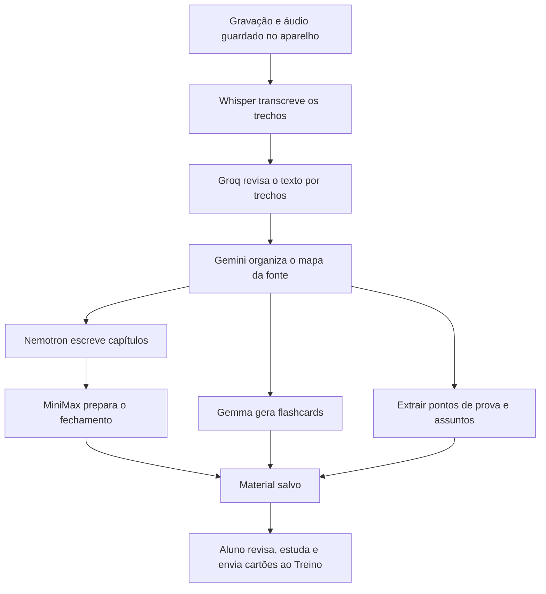

# Fluxo de IA por tarefa

Implementação: `src/ai-workflow.js`, usada pelo roteador `src/ai-provider.js`. A distribuição considera formato de entrada, tamanho do contexto e função de cada etapa. Não é um ranking de qualidade clínica e não garante fidelidade médica por si só.

| Etapa | Preferência inicial | Reserva |
| --- | --- | --- |
| Transcrição de áudio | Groq Whisper | Legenda local/áudio guardado, conforme fluxo existente |
| Revisão de transcrição por trechos | Groq | Gemini, OpenRouter |
| Mapa de capítulos, fontes longas e documentos | Gemini | OpenRouter, Groq |
| Capítulos narrativos e detalhamento de tarefas | OpenRouter / família Nemotron | MiniMax, Gemma; depois Gemini e Groq |
| Fechamento e síntese do volume | OpenRouter / família MiniMax | Nemotron, Gemma; depois Gemini e Groq |
| Flashcards e questões estruturadas | OpenRouter / família Gemma | Nemotron, MiniMax; depois Gemini e Groq |
| Chat do Mentor, Tutor e conferência de associações | Groq | Gemini, OpenRouter |
| Resumo geral e mapa mental sob demanda | Gemini | OpenRouter, Groq |

As preferências do OpenRouter reorganizam somente os modelos presentes em `OPENROUTER_MODELS`: não acrescentam um modelo não configurado nem ativam uma opção paga. O retorno informa o modelo que efetivamente respondeu, que pode ser uma reserva. Formatos JSON continuam sendo validados; `json_object` continua disponível como alternativa ao schema.

## Aula gravada

O gráfico mostra preferências de execução. Limites, disponibilidade e tamanho da fonte podem mudar o executor. Capítulos mantêm a ordem do mapa mesmo quando são gerados em paralelo. O pipeline já existente guarda resultados e retoma capítulos e etapas concluídos. Resumo geral e mapa mental continuam sob demanda; o mapa mental pode reaproveitar a estrutura local dos capítulos.

O cronograma segue o motor acadêmico do Claude, com rascunho, confirmação e replanejamento que preserva histórico. Esta mudança não gera um plano novo nem agenda automaticamente revisões de aulas. A fonte original e os prompts de fidelidade são mantidos.

## Roteamento e carga

- Perfis atuam em `AI_PROVIDER=auto`. Um provedor fixado continua sendo respeitado.
- `AI_ORDER_<TAREFA>` permite substituir a preferência da tarefa. Exemplo: `AI_ORDER_MENTOR_CHAT=groq,gemini,openrouter`.
- Chamadas sem tarefa continuam usando `AI_ORDER` e a política anterior.
- O roteador continua considerando contexto, limites e saúde dos provedores antes de escolher o executor. Fonte grande evita Groq como primeira escolha.
- Fila de texto compartilhada por todas as rotas **no mesmo processo**: `AI_MAX_PARALLEL=3`, Groq até 1, Gemini até 2, OpenRouter até 2.
- Fila limitada a 24 pedidos aguardando, com `AI_QUEUE_WAIT_MS=15000`. Uma falha libera a vaga. Solicitações diretas têm prioridade sobre a atualização automática de questões que ainda está aguardando.
- O teto é por processo/instância; não é um limitador distribuído entre todas as instâncias da Vercel nem substitui as cotas das APIs.
- A transcrição Whisper mantém o fluxo de áudio separado. Não foi adicionada transcrição alternativa por Gemini/OpenRouter.
- `/api/health` expõe `aiFluxo` e `/api/aula/status` inclui os perfis em `ia.workflow`, sem conteúdo de arquivos. Os logs identificam tarefa, provedor e modelo, sem guardar o prompt.

## Validação

Testes simulados: seleção por tarefa, prioridade de modelos, fallback entre provedores, contexto grande, provedor fixado, sobreposição de configuração, JSON, teto global, teto por provedor, expiração da espera, liberação de vaga após erro e prioridade sobre segundo plano. Testes das oito rotas de geração da Aula do dia conferem a tarefa enviada ao roteador. Suíte completa e build aprovados.

Teste real: cinco chamadas técnicas fictícias em paralelo, sem PDF, áudio ou dados pessoais. Todas retornaram JSON válido em aproximadamente 26,7 segundos no conjunto. Houve fallback no Gemini e seleção de modelos reserva no OpenRouter. Isso valida o roteamento, não o tempo de uma aula completa, nem a precisão clínica dos resumos. Gemma foi a preferência nos flashcards, mas a resposta dessa chamada veio do Nemotron pela reserva nativa.

Referências de capacidade: [Whisper na Groq](https://console.groq.com/docs/speech-to-text), [contexto longo do Gemini](https://ai.google.dev/gemini-api/docs/long-context) e [fallbacks do OpenRouter](https://openrouter.ai/docs/guides/routing/model-fallbacks). A escolha das responsabilidades é uma decisão de implementação, que deve ser calibrada com aulas representativas.
