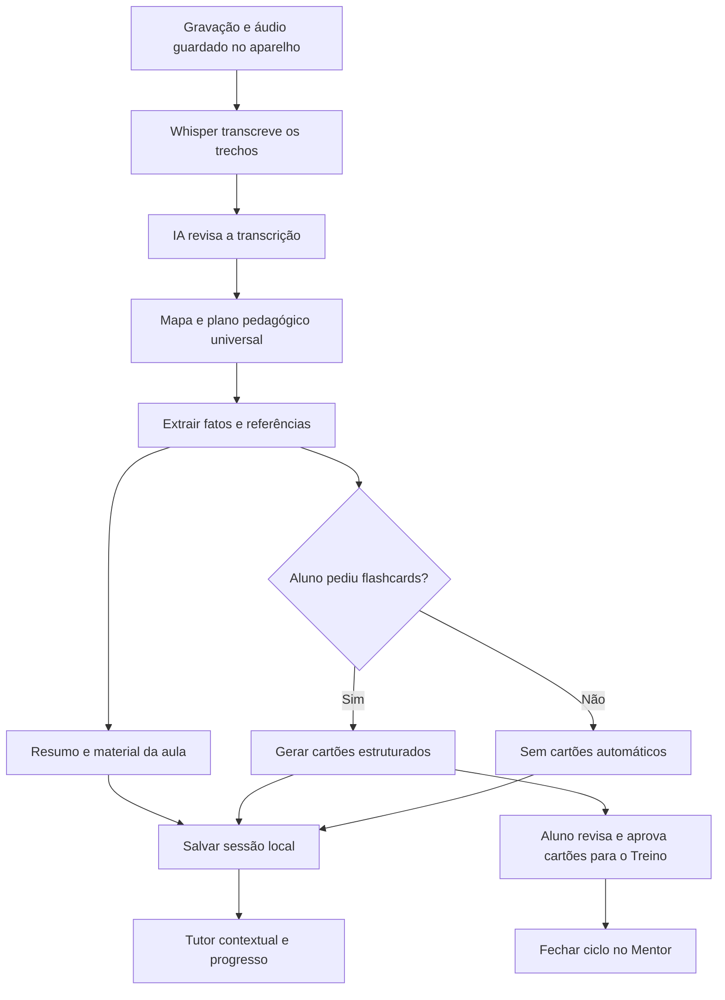

# Fluxo de IA por tarefa

Implementação: `src/ai-workflow.js`, usada pelo roteador `src/ai-provider.js`. A distribuição considera formato de entrada, tamanho do contexto e função de cada etapa. Não é um ranking de qualidade clínica e não garante fidelidade médica por si só.

| Etapa | Preferência inicial | Reserva |
| --- | --- | --- |
| Transcrição de áudio | Groq Whisper Large V3 Turbo | Gemini quando configurado como reserva |
| Revisão de transcrição por trechos e material da Aula do Dia | Gemini Flash | OpenRouter, Groq |
| Mapa de capítulos, fontes longas e documentos | Gemini Flash | OpenRouter, Groq |
| Capítulos narrativos, fechamento e detalhamento de tarefas | Gemini Flash | OpenRouter, Groq |
| Flashcards estruturados | Groq GPT-OSS 20B | OpenRouter, Gemini |
| Questões estruturadas | OpenRouter / família Gemma | Nemotron, MiniMax; depois Gemini e Groq |
| Chat, detalhamento do plano e associações do Mentor IA | Groq GPT-OSS 120B | Gemini, OpenRouter |
| Resumo geral e mapa mental sob demanda | Gemini | OpenRouter, Groq |
| Busca semântica no acervo | EmbeddingGemma no Hugging Face + Cohere Rerank | Similaridade vetorial sem reranker se Cohere falhar |

As preferências do OpenRouter reorganizam somente os modelos presentes em `OPENROUTER_MODELS`: não acrescentam um modelo não configurado nem ativam uma opção paga. O retorno informa o modelo que efetivamente respondeu, que pode ser uma reserva. Formatos JSON continuam sendo validados; `json_object` continua disponível como alternativa ao schema.

## Modelos por funcionalidade

`AI_TASKS` escolhe provedor e modelo por etapa, preservando o roteador, a fila, os limites de contexto e o fallback já existentes. As tarefas da Aula do Dia usam `gemini-2.5-flash` por padrão (`AULA_GEMINI_MODEL` altera o modelo para todas; `AI_MODEL_<TAREFA>_GEMINI` altera uma só tarefa). `aula_flashcards` usa `openai/gpt-oss-20b` na Groq; `mentor_chat`, `planner_enrich` e `planner_associacoes` usam `openai/gpt-oss-120b`. Se um provedor ou modelo falhar, o roteador pode seguir para os provedores de reserva configurados. Whisper continua isolado no endpoint de transcrição. O modelo aplicado aparece no status administrativo da IA.

O restante do sistema mantém `GEMINI_MODEL=gemini-3.8-flash` como padrão global. A Aula do Dia solicita `gemini-2.5-flash`; o Google informa que restringe o acesso à família 2.5 para contas que já a usavam. Se essa conta não tiver acesso, configure `AULA_GEMINI_MODEL=gemini-3.8-flash` ou garanta outro provedor de reserva em `AI_PROVIDER=auto`. Para cada tarefa, `AI_MODEL_<TAREFA>_<PROVEDOR>` substitui modelos Groq/Gemini; OpenRouter continua usando os candidatos e as famílias configurados. Um valor vazio mantém o padrão do código.

## Busca semântica

- `POST /api/acervo/busca-semantica` recebe a consulta, calcula o embedding com `google/embeddinggemma-300m`, compara com o índice vetorial e reordena os 40 melhores resultados com Cohere Rerank.
- A versão atual indexa **título, curso e caminho do catálogo**, não o texto integral dos PDFs nem o áudio das videoaulas. A busca semântica ajuda a localizar o material pelo assunto descrito nesses metadados.
- O índice fica em `acervo/semantic-index/` no bucket privado `acervo` do Supabase. Para criá-lo ou atualizá-lo após uma sincronização do catálogo, configure `HF_TOKEN`, `SUPABASE_URL` e `SUPABASE_SERVICE_ROLE_KEY`, aceite a licença Gemma no Hugging Face e rode `npm run index:acervo-semantico`. A busca requer também `COHERE_API_KEY` e o cliente Supabase com service role. O frontend mantém a busca textual local como alternativa.
- O índice usa vetores int8 normalizados para reduzir o armazenamento e é carregado uma vez por processo. Se o catálogo mudar, a API responde que o índice está desatualizado até ele ser regenerado.
- O Hugging Face inclui US$ 0,10 mensais para usuários gratuitos, sujeito a mudança; a chave de avaliação do Cohere é gratuita, mas limitada e o endpoint Rerank tem limite de 10 requisições/minuto. Isso não equivale a uso gratuito ilimitado.
- A consulta é enviada ao Hugging Face e os metadados dos resultados candidatos ao Cohere. Não inclua dados identificáveis de pacientes nas consultas.

## Mapas editáveis

O Gemini continua produzindo a árvore JSON que o Cuscuz-MED renderiza no mapa interativo existente. O botão **Mermaid (.mmd)** transforma essa mesma árvore localmente em um arquivo editável; não cria uma segunda chamada de IA nem depende de um serviço Mermaid externo.

## Aula gravada

O gráfico mostra responsabilidades do fluxo, não um provedor fixo. Limites, disponibilidade e tamanho da fonte podem mudar o executor. Capítulos mantêm a ordem do mapa mesmo quando são gerados em paralelo. O pipeline guarda resultados e retoma capítulos e etapas concluídos. Resumo geral e mapa mental continuam sob demanda; o mapa mental pode reaproveitar a estrutura local dos capítulos. O Tutor envia a pergunta e o contexto selecionado da aula ao provedor configurado; o histórico da conversa permanece local no navegador.

O cronograma segue o motor acadêmico do Claude, com rascunho, confirmação e replanejamento que preserva histórico. Esta mudança não gera um plano novo nem agenda automaticamente revisões de aulas. A fonte original e os prompts de fidelidade são mantidos.

## Roteamento e carga

- Perfis atuam em `AI_PROVIDER=auto`. Um provedor fixado continua sendo respeitado.
- `AI_ORDER_<TAREFA>` permite substituir a preferência da tarefa. Exemplo: `AI_ORDER_MENTOR_CHAT=groq,gemini,openrouter`.
- Chamadas sem tarefa continuam usando `AI_ORDER` e a política anterior.
- O roteador continua considerando contexto, limites e saúde dos provedores antes de escolher o executor. Fonte grande evita Groq como primeira escolha.
- Fila de texto compartilhada por todas as rotas **no mesmo processo**: `AI_MAX_PARALLEL=3`, Groq até 1, Gemini até 2, OpenRouter até 2.
- Fila limitada a 24 pedidos aguardando, com `AI_QUEUE_WAIT_MS=15000`. Uma falha libera a vaga. Solicitações diretas têm prioridade sobre a atualização automática de questões que ainda está aguardando.
- O teto é por processo/instância; não é um limitador distribuído entre todas as instâncias da Vercel nem substitui as cotas das APIs.
- A transcrição Whisper mantém o fluxo de áudio separado. Quando Groq não está configurada, falha ou retorna limite, Gemini pode servir de reserva; OpenRouter não recebe áudio.
- `/api/health` expõe detalhes de `aiFluxo` somente a administradores; `/api/aula/status` autenticado inclui os perfis em `ia.workflow`, sem conteúdo de arquivos. Os logs identificam tarefa, provedor e modelo, sem guardar o prompt.

## Validação

Testes simulados: seleção por tarefa, prioridade de modelos, fallback entre provedores, contexto grande, provedor fixado, sobreposição de configuração, JSON, teto global, teto por provedor, expiração da espera, liberação de vaga após erro e prioridade sobre segundo plano. Testes das oito rotas de geração da Aula do dia conferem a tarefa enviada ao roteador. Suíte completa e build aprovados.

Teste real: cinco chamadas técnicas fictícias em paralelo, sem PDF, áudio ou dados pessoais. Todas retornaram JSON válido em aproximadamente 26,7 segundos no conjunto. Houve fallback no Gemini e seleção de modelos reserva no OpenRouter. Isso valida o roteamento, não o tempo de uma aula completa, nem a precisão clínica dos resumos. Gemma foi a preferência nos flashcards, mas a resposta dessa chamada veio do Nemotron pela reserva nativa.

Referências de capacidade: [Whisper na Groq](https://console.groq.com/docs/speech-to-text), [contexto longo do Gemini](https://ai.google.dev/gemini-api/docs/long-context) e [fallbacks do OpenRouter](https://openrouter.ai/docs/guides/routing/model-fallbacks). A escolha das responsabilidades é uma decisão de implementação, que deve ser calibrada com aulas representativas.
